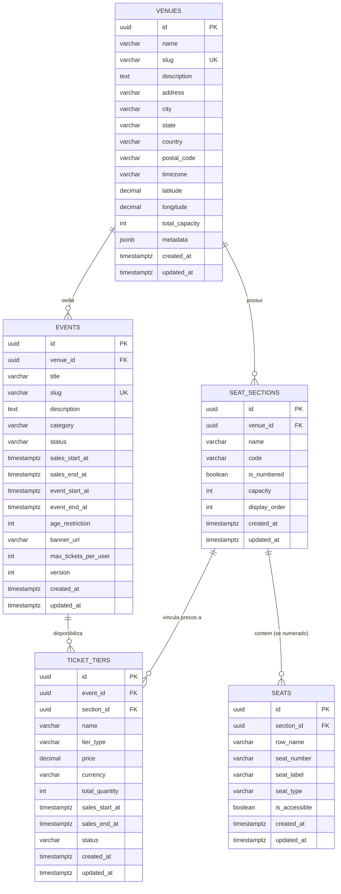

# Especificação de Banco de Dados: Catálogo de Eventos (`SVC_EVENTOS`)

Este documento especifica o modelo de dados físico, diagramas de entidade-relacionamento (ERD), definições de DDL (PostgreSQL), índices de alta performance, estratégia de cache no Redis, configurações para replicação via CDC (Debezium) e o mapeamento com o Domínio C# .NET 8 para o microsserviço de **Catálogo de Eventos** do ecossistema **TicketReserver.IO**.

---

## 1. Visão Geral do Domínio

* **Banco de Dados Relacional:** PostgreSQL 16+ (`Eventos DB`)
* **Camada de Cache:** Redis (`RedisCache`)
* **Streaming de Mudanças (CDC):** Debezium (PostgreSQL WAL -> Apache Kafka)
* **Objetivo:** Fonte autoritativa de informações mestras para locais (*venues*), setores, assentos físicos, eventos/espetáculos e lotes de ingressos (*ticket tiers*).



---

## 2. DDL PostgreSQL Completo

```sql
CREATE EXTENSION IF NOT EXISTS "uuid-ossp";

-- ============================================================================
-- 1. TABELA: VENUES (Locais, Arenas, Estádios e Teatros)
-- ============================================================================
CREATE TABLE venues (
    id UUID PRIMARY KEY DEFAULT uuid_generate_v4(),
    name VARCHAR(150) NOT NULL,
    slug VARCHAR(160) NOT NULL,
    description TEXT,
    address VARCHAR(255) NOT NULL,
    city VARCHAR(100) NOT NULL,
    state VARCHAR(50) NOT NULL,
    country VARCHAR(50) NOT NULL DEFAULT 'BR',
    postal_code VARCHAR(20) NOT NULL,
    timezone VARCHAR(50) NOT NULL DEFAULT 'America/Sao_Paulo',
    latitude NUMERIC(10, 8),
    longitude NUMERIC(11, 8),
    total_capacity INT NOT NULL CHECK (total_capacity > 0),
    metadata JSONB DEFAULT '{}'::jsonb,
    created_at TIMESTAMPTZ NOT NULL DEFAULT NOW(),
    updated_at TIMESTAMPTZ NOT NULL DEFAULT NOW(),

    CONSTRAINT uq_venues_slug UNIQUE (slug)
);

-- ============================================================================
-- 2. TABELA: SEAT_SECTIONS (Setores Físicos do Local)
-- ============================================================================
CREATE TABLE seat_sections (
    id UUID PRIMARY KEY DEFAULT uuid_generate_v4(),
    venue_id UUID NOT NULL,
    name VARCHAR(100) NOT NULL,
    code VARCHAR(30) NOT NULL,
    is_numbered BOOLEAN NOT NULL DEFAULT FALSE,
    capacity INT NOT NULL CHECK (capacity > 0),
    display_order INT NOT NULL DEFAULT 0,
    created_at TIMESTAMPTZ NOT NULL DEFAULT NOW(),
    updated_at TIMESTAMPTZ NOT NULL DEFAULT NOW(),

    CONSTRAINT fk_sections_venue FOREIGN KEY (venue_id) REFERENCES venues(id) ON DELETE RESTRICT,
    CONSTRAINT uq_sections_venue_code UNIQUE (venue_id, code)
);

-- ============================================================================
-- 3. TABELA: SEATS (Assentos Físicos para Setores Numerados)
-- ============================================================================
CREATE TABLE seats (
    id UUID PRIMARY KEY DEFAULT uuid_generate_v4(),
    section_id UUID NOT NULL,
    row_name VARCHAR(10) NOT NULL,            -- ex: 'A', 'B', '10'
    seat_number VARCHAR(10) NOT NULL,         -- ex: '1', '2', '101'
    seat_label VARCHAR(30) NOT NULL,          -- ex: 'A-12', 'PISTA-VIP-01'
    seat_type VARCHAR(30) NOT NULL DEFAULT 'STANDARD', -- 'STANDARD', 'WHEELCHAIR', 'VIP'
    is_accessible BOOLEAN NOT NULL DEFAULT FALSE,
    created_at TIMESTAMPTZ NOT NULL DEFAULT NOW(),
    updated_at TIMESTAMPTZ NOT NULL DEFAULT NOW(),

    CONSTRAINT fk_seats_section FOREIGN KEY (section_id) REFERENCES seat_sections(id) ON DELETE CASCADE,
    CONSTRAINT uq_seats_section_row_number UNIQUE (section_id, row_name, seat_number)
);

-- ============================================================================
-- 4. TABELA: EVENTS (Shows, Jogos, Festivais e Espetáculos)
-- ============================================================================
CREATE TYPE event_status_enum AS ENUM (
    'DRAFT',            -- Em planejamento
    'PUBLISHED',        -- Publicado no catálogo (vendas fechadas)
    'SALES_OPEN',       -- Vendas ativas
    'SALES_PAUSED',     -- Vendas suspensas temporariamente
    'SOLD_OUT',         -- Ingressos esgotados
    'CANCELLED',        -- Evento cancelado
    'FINISHED'          -- Evento realizado
);

CREATE TABLE events (
    id UUID PRIMARY KEY DEFAULT uuid_generate_v4(),
    venue_id UUID NOT NULL,
    title VARCHAR(200) NOT NULL,
    slug VARCHAR(220) NOT NULL,
    description TEXT,
    category VARCHAR(60) NOT NULL,            -- 'CONCERT', 'SPORTS', 'THEATER', 'FESTIVAL'
    status event_status_enum NOT NULL DEFAULT 'DRAFT',
    sales_start_at TIMESTAMPTZ NOT NULL,
    sales_end_at TIMESTAMPTZ NOT NULL,
    event_start_at TIMESTAMPTZ NOT NULL,
    event_end_at TIMESTAMPTZ NOT NULL,
    age_restriction INT NOT NULL DEFAULT 0,   -- Idade mínima (0 = Livre)
    banner_url VARCHAR(500),
    max_tickets_per_user INT NOT NULL DEFAULT 4 CHECK (max_tickets_per_user > 0),
    version INT NOT NULL DEFAULT 1,           -- Optimistic Concurrency Control
    created_at TIMESTAMPTZ NOT NULL DEFAULT NOW(),
    updated_at TIMESTAMPTZ NOT NULL DEFAULT NOW(),

    CONSTRAINT fk_events_venue FOREIGN KEY (venue_id) REFERENCES venues(id) ON DELETE RESTRICT,
    CONSTRAINT uq_events_slug UNIQUE (slug),
    CONSTRAINT chk_events_sales_window CHECK (sales_end_at > sales_start_at),
    CONSTRAINT chk_events_schedule CHECK (event_end_at > event_start_at),
    CONSTRAINT chk_events_dates_order CHECK (event_start_at >= sales_start_at)
);

-- ============================================================================
-- 5. TABELA: TICKET_TIERS (Lotes e Preços por Setor / Tipo de Ingresso)
-- ============================================================================
CREATE TYPE ticket_tier_type_enum AS ENUM (
    'STANDARD',         -- Inteira
    'HALF_PRICE',       -- Meia-entrada
    'VIP_EXPERIENCE',   -- Pacote VIP
    'EARLY_BIRD',       -- Lote promocional antecipado
    'SPONSOR'           -- Cortesia / patrocinador
);

CREATE TYPE ticket_tier_status_enum AS ENUM (
    'SCHEDULED',        -- Programado para liberação futura
    'ACTIVE',           -- Aberto para vendas
    'SOLD_OUT',         -- Esgotado
    'EXPIRED'           -- Período de venda encerrado
);

CREATE TABLE ticket_tiers (
    id UUID PRIMARY KEY DEFAULT uuid_generate_v4(),
    event_id UUID NOT NULL,
    section_id UUID NOT NULL,
    name VARCHAR(100) NOT NULL,               -- ex: '1º Lote - Pista Inteira'
    tier_type ticket_tier_type_enum NOT NULL DEFAULT 'STANDARD',
    price NUMERIC(12, 2) NOT NULL CHECK (price >= 0),
    currency VARCHAR(3) NOT NULL DEFAULT 'BRL',
    total_quantity INT NOT NULL CHECK (total_quantity > 0),
    sales_start_at TIMESTAMPTZ NOT NULL,
    sales_end_at TIMESTAMPTZ NOT NULL,
    status ticket_tier_status_enum NOT NULL DEFAULT 'SCHEDULED',
    created_at TIMESTAMPTZ NOT NULL DEFAULT NOW(),
    updated_at TIMESTAMPTZ NOT NULL DEFAULT NOW(),

    CONSTRAINT fk_ticket_tiers_event FOREIGN KEY (event_id) REFERENCES events(id) ON DELETE CASCADE,
    CONSTRAINT fk_ticket_tiers_section FOREIGN KEY (section_id) REFERENCES seat_sections(id) ON DELETE RESTRICT,
    CONSTRAINT chk_tiers_sales_dates CHECK (sales_end_at > sales_start_at)
);
```

---

## 3. Índices de Performance

```sql
-- Consultas filtradas por eventos ativos e ordenados por data
CREATE INDEX idx_events_status_start_at 
ON events (status, event_start_at) 
WHERE status IN ('PUBLISHED', 'SALES_OPEN');

-- Consultas de catálogo por categoria
CREATE INDEX idx_events_category ON events (category);

-- Busca de locais por cidade
CREATE INDEX idx_venues_city ON venues (city);

-- Listagem de lotes/preços de um evento específico
CREATE INDEX idx_ticket_tiers_event_status 
ON ticket_tiers (event_id, status);

-- Resolução de assentos por setor
CREATE INDEX idx_seats_section ON seats (section_id);
```

---

## 4. Configuração para CDC (Debezium Engine)

Para garantir que o Debezium capture o estado anterior e novo (before e after) em cada operação no WAL do PostgreSQL:

```sql
ALTER TABLE venues REPLICA IDENTITY FULL;
ALTER TABLE events REPLICA IDENTITY FULL;
ALTER TABLE seat_sections REPLICA IDENTITY FULL;
ALTER TABLE ticket_tiers REPLICA IDENTITY FULL;
ALTER TABLE seats REPLICA IDENTITY FULL;
```

**Tópicos gerados no Apache Kafka:**
1. `catalog.events.venues`
2. `catalog.events.events`
3. `catalog.events.seat_sections`
4. `catalog.events.ticket_tiers`
5. `catalog.events.seats`

*Consumidores principais:* Worker de Replicação (`HWRepl`) do microsserviço de Busca (`SVC_BUSCA`) para atualizar o ElasticSearch.

---

## 5. Estratégia de Cache no Redis (`RedisCache`)

| Chave Redis | Tipo | TTL | Propósito | Invalidação |
| :--- | :--- | :--- | :--- | :--- |
| `catalog:event:{id}` | String (JSON) | 1 hora | Dados detalhados do evento para renderização rápida de página | No update/delete do evento via API |
| `catalog:event:{id}:tiers` | String (JSON) | 5 minutos | Setores e lotes disponíveis para o evento | Ao esgotar ou alterar status de tier |
| `catalog:featured_events` | Sorted Set | 30 minutos | IDs dos eventos em destaque (Score = timestamp do evento) | Rotina periódica / publicação |

---

## 6. Mapeamento com Domínio C# .NET 8 (Clean Architecture)

Em conformidade com [PROJECT.md](file:///home/thallesteodoro/development/ticket-reservation-pdi/PROJECT.md):

* **Entidades Ricas:**
  * `Event.cs`:
    * Método estático de fábrica `Event.Create(venueId, title, slug, category, salesWindow, schedule, ageRestriction)` validando invariantes temporais.
    * Métodos de negócio: `Publish()`, `OpenSales()`, `PauseSales()`, `Cancel()`, `SoldOut()`.
    * Coleção de lotes: `private readonly List<TicketTier> _ticketTiers = new();` exposta como `public IReadOnlyCollection<TicketTier> TicketTiers => _ticketTiers.AsReadOnly();`.
* **Value Objects:**
  * `Money(decimal Amount, string Currency)`
  * `DateTimeRange(DateTimeOffset Start, DateTimeOffset End)`
  * `Address(string Street, string City, string State, string Country, string PostalCode)`
* **Persistência EF Core:**
  * Mapeamentos explícitos em `Infrastructure/Persistence/Configuration/` implementando `IEntityTypeConfiguration<T>` com Fluent API. Proibido uso de Data Annotations no Domínio.
