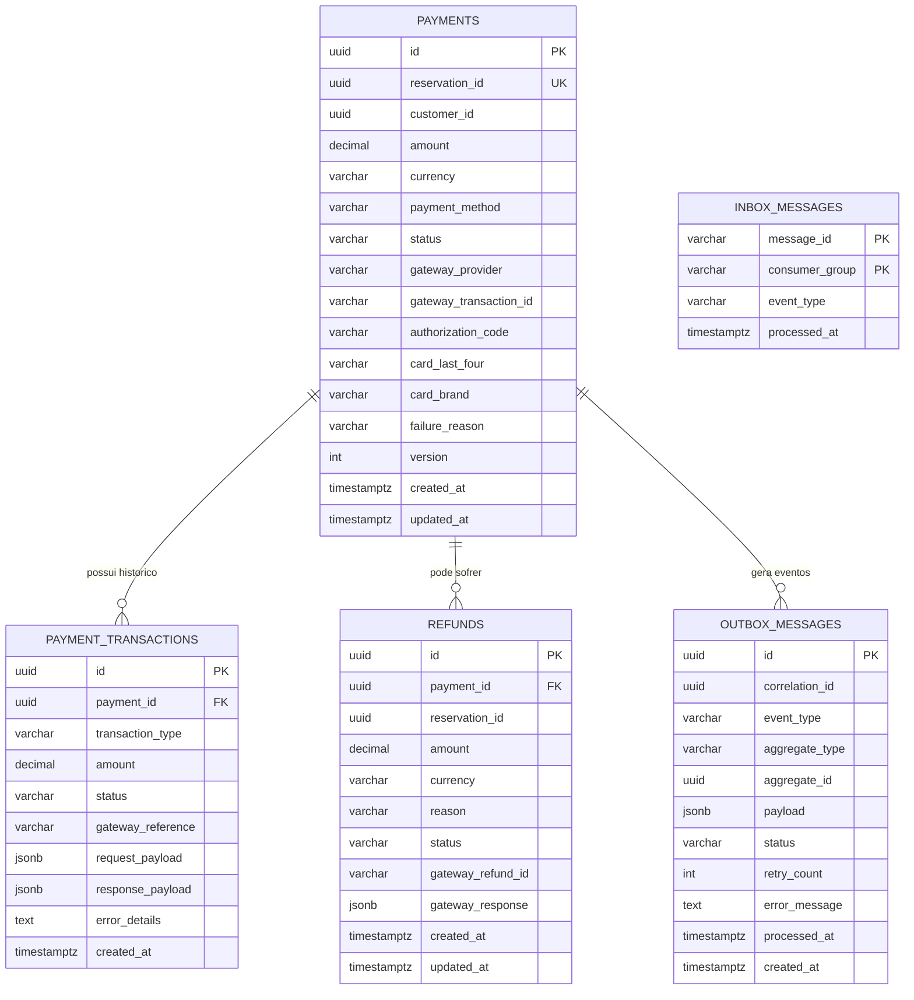

# Especificação de Banco de Dados: Pagamento (`SVC_PAGAMENTO`)

Este documento especifica o modelo de dados físico, diagramas de entidade-relacionamento (ERD), definições de DDL (PostgreSQL), tabelas de transações e estornos (*Auto-Refund*), garantias de idempotência contra cobrança dupla e os padrões de resiliência nos workers **`TR.HW.Payment`** e **`TR.HW.Refund`** para o ecossistema **TicketReserver.IO**.

---

## 1. Visão Geral do Domínio

* **Banco de Dados Relacional:** PostgreSQL 16+ (`Pagamento DB`)
* **Papel no Sistema:** Orquestrar cobranças com gateways externos (Stripe, Cielo, Adquirentes), manter ledger financeiro imutável de transações e executar estornos automáticos (*Auto-Refund*) acionados pela falha de concorrência na emissão do ingresso.
* **Workers Integrados:**
  * **`TR.HW.Payment`:** Consome o evento `reservation.v1.checkout_req`, valida idempotência, processa a cobrança no gateway externo e, em caso de sucesso, grava na base e emite `payment.v1.approved` via Outbox.
  * **`TR.HW.Refund`:** Consome o evento `ticketing.v1.failed`, efetua estorno/cancelamento imediato (*Void / Refund*) no gateway externo, atualiza o status financeiro para `REFUNDED` e publica `payment.v1.refunded` via Outbox para cancelar a reserva e notificar o usuário.

---

## 2. Diagrama Entidade-Relacionamento (ERD)



---

## 3. DDL PostgreSQL Completo

```sql
CREATE EXTENSION IF NOT EXISTS "uuid-ossp";

-- ============================================================================
-- 1. ENUMS E TABELA: PAYMENTS
-- ============================================================================
CREATE TYPE payment_status_enum AS ENUM (
    'PENDING',              -- Registro criado, aguardando resposta do gateway
    'AUTHORIZED',           -- Pré-autorizado no cartão
    'CAPTURED',             -- Capturado com sucesso (Dinheiro liquidado)
    'DECLINED',             -- Recusado pelo gateway/emissor (saldo, antifraude, etc.)
    'REFUNDED',             -- Estornado integralmente
    'PARTIALLY_REFUNDED',   -- Estornado parcialmente
    'FAILED'                -- Falha técnica irrecuperável de comunicação
);

CREATE TYPE payment_method_enum AS ENUM (
    'CREDIT_CARD',
    'DEBIT_CARD',
    'PIX'
);

CREATE TABLE payments (
    id UUID PRIMARY KEY DEFAULT uuid_generate_v4(),
    reservation_id UUID NOT NULL,
    customer_id UUID NOT NULL,
    amount NUMERIC(12, 2) NOT NULL CHECK (amount > 0),
    currency VARCHAR(3) NOT NULL DEFAULT 'BRL',
    payment_method payment_method_enum NOT NULL DEFAULT 'CREDIT_CARD',
    status payment_status_enum NOT NULL DEFAULT 'PENDING',
    gateway_provider VARCHAR(50) NOT NULL DEFAULT 'STRIPE',
    gateway_transaction_id VARCHAR(100),
    authorization_code VARCHAR(50),
    card_last_four VARCHAR(4),
    card_brand VARCHAR(30),
    failure_reason VARCHAR(255),
    version INT NOT NULL DEFAULT 1,             -- Optimistic Concurrency Control
    created_at TIMESTAMPTZ NOT NULL DEFAULT NOW(),
    updated_at TIMESTAMPTZ NOT NULL DEFAULT NOW(),

    -- REGRA DE OURO: Impede que uma mesma reserva seja cobrada duas vezes
    CONSTRAINT uq_payments_reservation_id UNIQUE (reservation_id)
);

-- ============================================================================
-- 2. TABELA: PAYMENT_TRANSACTIONS (Ledger / Log Imutável de Chamadas de Gateway)
-- ============================================================================
CREATE TYPE transaction_type_enum AS ENUM (
    'AUTHORIZE',
    'CAPTURE',
    'VOID',
    'REFUND'
);

CREATE TYPE transaction_status_enum AS ENUM (
    'SUCCESS',
    'FAILED'
);

CREATE TABLE payment_transactions (
    id UUID PRIMARY KEY DEFAULT uuid_generate_v4(),
    payment_id UUID NOT NULL,
    transaction_type transaction_type_enum NOT NULL,
    amount NUMERIC(12, 2) NOT NULL CHECK (amount > 0),
    status transaction_status_enum NOT NULL,
    gateway_reference VARCHAR(150),
    request_payload JSONB,
    response_payload JSONB,
    error_details TEXT,
    created_at TIMESTAMPTZ NOT NULL DEFAULT NOW(),

    CONSTRAINT fk_transactions_payment FOREIGN KEY (payment_id) REFERENCES payments(id) ON DELETE RESTRICT
);

-- ============================================================================
-- 3. TABELA: REFUNDS (Registro de Estornos / Auto-Refund)
-- ============================================================================
CREATE TYPE refund_status_enum AS ENUM (
    'PENDING',
    'COMPLETED',
    'FAILED'
);

CREATE TABLE refunds (
    id UUID PRIMARY KEY DEFAULT uuid_generate_v4(),
    payment_id UUID NOT NULL,
    reservation_id UUID NOT NULL,
    amount NUMERIC(12, 2) NOT NULL CHECK (amount > 0),
    currency VARCHAR(3) NOT NULL DEFAULT 'BRL',
    reason VARCHAR(150) NOT NULL,               -- ex: 'SEAT_ALLOCATION_FAILED', 'CUSTOMER_CANCELLATION'
    status refund_status_enum NOT NULL DEFAULT 'PENDING',
    gateway_refund_id VARCHAR(100),
    gateway_response JSONB,
    created_at TIMESTAMPTZ NOT NULL DEFAULT NOW(),
    updated_at TIMESTAMPTZ NOT NULL DEFAULT NOW(),

    CONSTRAINT fk_refunds_payment FOREIGN KEY (payment_id) REFERENCES payments(id) ON DELETE RESTRICT
);

-- ============================================================================
-- 4. TABELA: OUTBOX_MESSAGES (Transactional Outbox)
-- ============================================================================
CREATE TYPE payment_outbox_status_enum AS ENUM (
    'PENDING',
    'PROCESSING',
    'PUBLISHED',
    'FAILED'
);

CREATE TABLE outbox_messages (
    id UUID PRIMARY KEY DEFAULT uuid_generate_v4(),
    correlation_id UUID NOT NULL,
    event_type VARCHAR(150) NOT NULL,           -- 'payment.approved', 'payment.refunded', 'payment.declined'
    aggregate_type VARCHAR(100) NOT NULL,       -- 'Payment'
    aggregate_id UUID NOT NULL,
    payload JSONB NOT NULL,
    status payment_outbox_status_enum NOT NULL DEFAULT 'PENDING',
    retry_count INT NOT NULL DEFAULT 0,
    error_message TEXT,
    processed_at TIMESTAMPTZ,
    created_at TIMESTAMPTZ NOT NULL DEFAULT NOW()
);

-- ============================================================================
-- 5. TABELA: INBOX_MESSAGES (Idempotência no Consumo Kafka)
-- ============================================================================
CREATE TABLE inbox_messages (
    message_id VARCHAR(150) NOT NULL,
    consumer_group VARCHAR(100) NOT NULL,
    event_type VARCHAR(150) NOT NULL,
    processed_at TIMESTAMPTZ NOT NULL DEFAULT NOW(),

    CONSTRAINT pk_payment_inbox PRIMARY KEY (message_id, consumer_group)
);
```

---

## 4. Índices e Otimizações de Concorrência

```sql
-- Busca de pagamentos por status e cliente
CREATE INDEX idx_payments_customer_status 
ON payments (customer_id, status);

-- Busca de pagamento por ID do gateway (para webhooks e conciliação)
CREATE INDEX idx_payments_gateway_tx 
ON payments (gateway_transaction_id) 
WHERE gateway_transaction_id IS NOT NULL;

-- Polling de Outbox ordenado com concorrência segura
CREATE INDEX idx_payment_outbox_pending 
ON outbox_messages (created_at, status) 
WHERE status = 'PENDING';

-- Histórico de transações por pagamento
CREATE INDEX idx_transactions_payment ON payment_transactions (payment_id);

-- Estornos por reserva
CREATE INDEX idx_refunds_reservation ON refunds (reservation_id);
```

---

## 5. Dinâmica dos Workers de Mensageria

### 5.1. `TR.HW.Payment` (Processamento de Checkout)
1. Consome `reservation.v1.checkout_req` do Kafka com `EnableAutoCommit = false`.
2. Verifica se a mensagem já existe em `inbox_messages`. Se existir, pula (idempotência).
3. Verifica se já existe pagamento para `reservation_id` (graças à constraint `uq_payments_reservation_id`).
4. Invoca o Gateway de Pagamento (Stripe/Cielo) envolvido em política **Polly** (Retry com Exponential Backoff para falhas transitórias de rede).
5. Abre transação no PostgreSQL:
   * Cria o registro em `payments` com status `CAPTURED` (ou `DECLINED`).
   * Grava a tentativa no ledger `payment_transactions`.
   * Insere em `outbox_messages` o evento `payment.v1.approved` (ou `payment.v1.declined`).
   * Insere o ID da mensagem em `inbox_messages`.
   * Efetua o `COMMIT`.
6. Realiza o commit manual do offset no Kafka.

### 5.2. `TR.HW.Refund` (Worker Dedicado a Estorno Automático)
1. Consome `ticketing.v1.failed` do Kafka (emitido quando o `TR.HW.Ticketing` detecta colisão de assento).
2. Verifica duplicidade na tabela `inbox_messages`.
3. Localiza o pagamento associado à reserva:
   ```sql
   SELECT * FROM payments WHERE reservation_id = @ReservationId AND status = 'CAPTURED';
   ```
4. Invoca a API do Gateway externo solicitando o cancelamento/estorno total:
   * Envia `gateway_transaction_id` e o valor integral.
   * Recebe o `gateway_refund_id`.
5. Em transação no PostgreSQL:
   * Atualiza `payments` com `status = 'REFUNDED'`.
   * Insere registro detalhado na tabela `refunds`.
   * Insere no ledger `payment_transactions` o tipo `REFUND`.
   * Insere em `outbox_messages` o evento `payment.v1.refunded`.
   * Registra em `inbox_messages`.
   * Efetua o `COMMIT`.
6. Commita manualmente o offset no Kafka.
7. O worker de Outbox publica `payment.v1.refunded` no Kafka, disparando em paralelo:
   * A compensação na Reserva (`Worker_Compensacao` altera status para `CANCELLED`).
   * O aviso de estorno no microsserviço de Notificação (`Worker_Notif`).

---

## 6. Mapeamento com Domínio C# .NET 8 (Clean Architecture)

Conforme as diretrizes de [PROJECT.md](file:///home/thallesteodoro/development/ticket-reservation-pdi/PROJECT.md):

* **Agregado Raiz `Payment.cs`:**
  * Invariantes financeiras: valor estritamente maior que zero, moeda padrão (`BRL`).
  * Métodos de transição de estado estritos:
    * `Payment.CreatePending(reservationId, customerId, amount, method, provider)`
    * `Capture(gatewayTransactionId, authorizationCode)`: Transiciona de `Pending` para `Captured`. Dispara `PaymentApprovedDomainEvent`.
    * `Decline(reason)`: Transiciona de `Pending` para `Declined`. Dispara `PaymentDeclinedDomainEvent`.
    * `Refund(reason)`: Valida se o status atual é `Captured`. Transiciona para `Refunded`. Dispara `PaymentRefundedDomainEvent`.
  * Coleção de transações protegida:
    ```csharp
    private readonly List<PaymentTransaction> _transactions = new();
    public IReadOnlyCollection<PaymentTransaction> Transactions => _transactions.AsReadOnly();
    ```
* **Resiliência Polly no Adaptador de Gateway:**
  ```csharp
  // Pipeline de execução segura no Gateway de Pagamento
  var policy = Policy
      .Handle<HttpRequestException>()
      .Or<TimeoutException>()
      .WaitAndRetryAsync(3, retryAttempt => 
          TimeSpan.FromSeconds(Math.Pow(2, retryAttempt)) + TimeSpan.FromMilliseconds(Random.Shared.Next(0, 100)));
  ```
* **Endpoints Carter (se houver consulta/webhook):**
  * `GET /pagamentos/{id}` -> Retorna `JsonResponse<PaymentResponse, object>`.
  * Respostas sem tipos crus.
