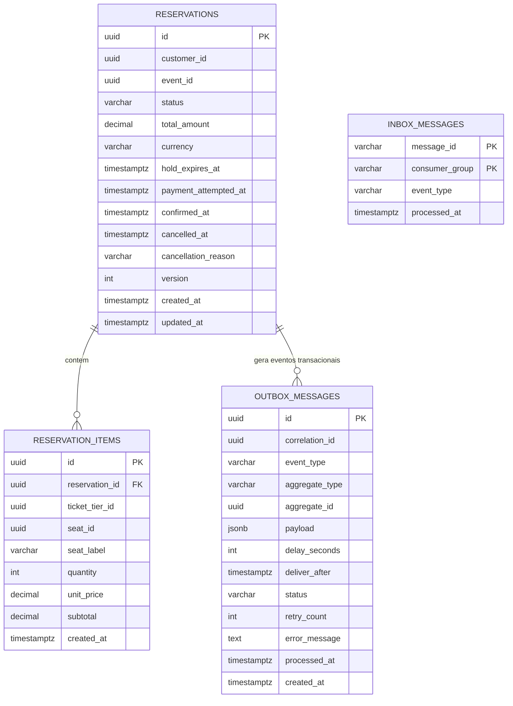

# Especificação de Banco de Dados: Reserva (`SVC_RESERVA`)

Este documento especifica o modelo de dados físico, diagramas de entidade-relacionamento (ERD), definições de DDL (PostgreSQL), mecanismos de Distributed Lock no Redis (Seat Hold), tabelas de resiliência transacional (**Outbox / Inbox**) e o mapeamento com o Domínio C# .NET 8 para o microsserviço de **Reserva** (`SVC_RESERVA`) do ecossistema **TicketReserver.IO**.

---

## 1. Visão Geral do Domínio

* **Banco de Dados Relacional:** PostgreSQL 16+ (`Reserva DB`)
* **Distributed Lock & TTL:** Redis (`RedisHold`)
* **Padrões de Resiliência:** 
  * **Transactional Outbox:** Garantia de persistência atômica entre mudança de status e publicação no Kafka.
  * **Inbox Pattern:** Desduplicação idempotente para eventos consumidos (ex: `payment.refunded`).
* **Workers Integrados:**
  * `TR.API.Reservation`: Recebe `/hold` e `/checkout`.
  * `Worker: OutboxRelay`: Lê `outbox_messages` (com `FOR UPDATE SKIP LOCKED`) e despacha:
    * `/hold`: publica em `Kafka_Delayed` o evento `reservation.hold_created` com delay de 10 min.
    * `/checkout`: publica no `Kafka` principal o evento imediato `reservation.checkout_req`.
  * `Worker: Check Timeout` (`TR.HW.ResTimeout`): Consome de `Kafka_Delayed` após 10 min e expira reservas que não foram pagas.
  * `Worker: Compensação`: Consome `payment.refunded` do Kafka e transiciona a reserva para `CANCELLED`.

---

## 2. Diagrama Entidade-Relacionamento (ERD)



---

## 3. DDL PostgreSQL Completo

```sql
CREATE EXTENSION IF NOT EXISTS "uuid-ossp";

-- ============================================================================
-- 1. ENUM E TABELA: RESERVATIONS
-- ============================================================================
CREATE TYPE reservation_status_enum AS ENUM (
    'AWAITING_PAYMENT',     -- Hold ativo, aguardando início do checkout
    'PROCESSING_PAYMENT',   -- Usuário iniciou pagamento (checkout disparado)
    'CONFIRMED',            -- Pagamento aprovado e ingresso emitido com sucesso
    'EXPIRED',              -- 10 minutos esgotados sem confirmação de pagamento
    'CANCELLED'             -- Cancelada pelo usuário ou compensada por estorno
);

CREATE TABLE reservations (
    id UUID PRIMARY KEY DEFAULT uuid_generate_v4(),
    customer_id UUID NOT NULL,
    event_id UUID NOT NULL,
    status reservation_status_enum NOT NULL DEFAULT 'AWAITING_PAYMENT',
    total_amount NUMERIC(12, 2) NOT NULL CHECK (total_amount >= 0),
    currency VARCHAR(3) NOT NULL DEFAULT 'BRL',
    hold_expires_at TIMESTAMPTZ NOT NULL,
    payment_attempted_at TIMESTAMPTZ,
    confirmed_at TIMESTAMPTZ,
    cancelled_at TIMESTAMPTZ,
    cancellation_reason VARCHAR(150),
    version INT NOT NULL DEFAULT 1,             -- Optimistic Concurrency Control
    created_at TIMESTAMPTZ NOT NULL DEFAULT NOW(),
    updated_at TIMESTAMPTZ NOT NULL DEFAULT NOW()
);

-- ============================================================================
-- 2. TABELA: RESERVATION_ITEMS (Assentos ou Lotes Vinculados à Reserva)
-- ============================================================================
CREATE TABLE reservation_items (
    id UUID PRIMARY KEY DEFAULT uuid_generate_v4(),
    reservation_id UUID NOT NULL,
    ticket_tier_id UUID NOT NULL,
    seat_id UUID,                               -- NULL para assentos não-numerados (ex: Pista Comum)
    seat_label VARCHAR(50),                     -- Denormalizado para agilidade visual (ex: 'Bloco A, Fileira 10, Assento 14')
    quantity INT NOT NULL DEFAULT 1 CHECK (quantity > 0),
    unit_price NUMERIC(12, 2) NOT NULL CHECK (unit_price >= 0),
    subtotal NUMERIC(12, 2) NOT NULL CHECK (subtotal >= 0),
    created_at TIMESTAMPTZ NOT NULL DEFAULT NOW(),

    CONSTRAINT fk_res_items_reservation FOREIGN KEY (reservation_id) REFERENCES reservations(id) ON DELETE CASCADE
);

-- ============================================================================
-- 3. TABELA: OUTBOX_MESSAGES (Transactional Outbox Pattern)
-- ============================================================================
CREATE TYPE outbox_status_enum AS ENUM (
    'PENDING',
    'PROCESSING',
    'PUBLISHED',
    'FAILED'
);

CREATE TABLE outbox_messages (
    id UUID PRIMARY KEY DEFAULT uuid_generate_v4(),
    correlation_id UUID NOT NULL,
    event_type VARCHAR(150) NOT NULL,           -- 'reservation.hold_created', 'reservation.checkout_req'
    aggregate_type VARCHAR(100) NOT NULL,       -- 'Reservation'
    aggregate_id UUID NOT NULL,
    payload JSONB NOT NULL,
    delay_seconds INT NOT NULL DEFAULT 0,       -- 0 = Imediato, 600 = Tópico com delay de 10 min
    deliver_after TIMESTAMPTZ NOT NULL DEFAULT NOW(),
    status outbox_status_enum NOT NULL DEFAULT 'PENDING',
    retry_count INT NOT NULL DEFAULT 0,
    error_message TEXT,
    processed_at TIMESTAMPTZ,
    created_at TIMESTAMPTZ NOT NULL DEFAULT NOW()
);

-- ============================================================================
-- 4. TABELA: INBOX_MESSAGES (Idempotência / Desduplicação de Consumo)
-- ============================================================================
CREATE TABLE inbox_messages (
    message_id VARCHAR(150) NOT NULL,
    consumer_group VARCHAR(100) NOT NULL,
    event_type VARCHAR(150) NOT NULL,
    processed_at TIMESTAMPTZ NOT NULL DEFAULT NOW(),

    CONSTRAINT pk_inbox_messages PRIMARY KEY (message_id, consumer_group)
);
```

---

## 4. Índices de Performance e Concorrência

```sql
-- Busca rápida de reservas ativas por cliente (para tela de checkout)
CREATE INDEX idx_reservations_customer_status 
ON reservations (customer_id, status);

-- Otimização extrema para o Outbox Relay (Worker lê pendentes ordenados por liberação)
CREATE INDEX idx_outbox_pending 
ON outbox_messages (deliver_after, status) 
WHERE status = 'PENDING';

-- Otimização para expiração rápida via job de contingência caso o Kafka atrase
CREATE INDEX idx_reservations_timeout_check 
ON reservations (hold_expires_at, status) 
WHERE status = 'AWAITING_PAYMENT';

-- Itens por reserva
CREATE INDEX idx_res_items_reservation ON reservation_items (reservation_id);
```

---

## 5. Arquitetura do Seat Hold no Redis (`RedisHold`)

Para evitar *Deadlocks* e *Row-Level Locking* no PostgreSQL sob concorrência maciça:

### 5.1. Padrão de Chave e TTL
* **Assento Numerado:**
  * Chave: `hold:event:{eventId}:seat:{seatId}`
  * Comando Atômico de Hold (10 minutos = 600 segundos):
    ```redis
    SET hold:event:{eventId}:seat:{seatId} "{reservationId}" NX EX 600
    ```
  * Se o retorno for `OK`, o assento foi garantido na memória RAM. Prossiga para salvar a reserva no PostgreSQL.
  * Se o retorno for `nil`, o assento já está em posse de outro usuário. Retorne HTTP 409 Conflict imediatamente.

### 5.2. Liberação Antecipada (Fast Fail / Rollback Seguro via Lua Script)
Se o usuário cancelar o carrinho ou o pagamento falhar imediatamente, o lock no Redis deve ser liberado apenas se pertencer àquela reserva:

```lua
-- KEYS[1] = hold:event:{eventId}:seat:{seatId}
-- ARGV[1] = reservationId
if redis.call("get", KEYS[1]) == ARGV[1] then
    return redis.call("del", KEYS[1])
else
    return 0
end
```

---

## 6. Fluxo de Publicação e Consumo dos Workers

### 6.1. Worker: `OutboxRelay` (PostgreSQL -> Kafka)
1. Executa polling determinístico no banco com bloqueio pessimista sem colisão entre instâncias concorrentes:
   ```sql
   SELECT * FROM outbox_messages
   WHERE status = 'PENDING' AND deliver_after <= NOW()
   ORDER BY deliver_after ASC
   LIMIT 100
   FOR UPDATE SKIP LOCKED;
   ```
2. Roteamento:
   * Se `delay_seconds > 0` (ex: `reservation.hold_created` com delay de 600s): publica no tópico **`Kafka_Delayed`** (`reservation.v1.hold_created.delayed`).
   * Se `delay_seconds == 0` (ex: `reservation.checkout_req`): publica no tópico principal do **`Kafka`** (`reservation.v1.checkout_req`).
3. Atualiza `status = 'PUBLISHED'` e `processed_at = NOW()` na mesma transação.

### 6.2. Worker: `TR.HW.ResTimeout` (Reconciliação de 10 min)
1. Consome do tópico `reservation.v1.hold_created.delayed` (entregue pelo Kafka somente após decorridos os 10 minutos).
2. Valida no `inbox_messages` se a mensagem já foi processada.
3. Busca a reserva no PostgreSQL:
   * Se `status == 'AWAITING_PAYMENT'`: altera status para `'EXPIRED'`, registra `cancellation_reason = 'PAYMENT_TIMEOUT'` e remove as chaves correspondentes no Redis.
   * Se `status` já for `'PROCESSING_PAYMENT'` ou `'CONFIRMED'`: nenhuma ação de expiração é tomada (o usuário já está no fluxo de pagamento ou concluiu).
4. Commita o offset do Kafka manualmente.

### 6.3. Worker: Compensação (Rollback de Saga)
1. Consome do tópico `payment.v1.refunded`.
2. Verifica duplicidade na tabela `inbox_messages`.
3. Altera a reserva para `status = 'CANCELLED'` e `cancellation_reason = 'AUTO_REFUND_SEAT_COLLISION'`.
4. Commita o offset do Kafka.

---

## 7. Mapeamento com Domínio C# .NET 8 (Clean Architecture)

Conforme [PROJECT.md](file:///home/thallesteodoro/development/ticket-reservation-pdi/PROJECT.md):

* **Agregado Raiz `Reservation.cs`:**
  * Construtor privado para o EF Core.
  * Fábrica estática `Reservation.CreateHold(customerId, eventId, items, holdDurationMinutes)` garantindo:
    * Total da reserva maior que zero.
    * Lista de itens não vazia.
    * Invariante temporal: `hold_expires_at = DateTimeOffset.UtcNow.AddMinutes(holdDurationMinutes)`.
    * Gravação do evento de domínio `ReservationHoldCreatedDomainEvent`.
  * Método `StartCheckout()`:
    * Valida: se `Status != ReservationStatus.AwaitingPayment`, dispara `DomainException("Reserva não está disponível para checkout.")`.
    * Se `DateTimeOffset.UtcNow > HoldExpiresAt`, dispara `DomainException("Tempo de reserva expirado.")`.
    * Transiciona para `ReservationStatus.ProcessingPayment` e grava evento `ReservationCheckoutRequestedDomainEvent`.
  * Método `Expire()`:
    * Valida se ainda está `AwaitingPayment`. Transiciona para `Expired`.
  * Método `Cancel(string reason)`:
    * Transiciona para `Cancelled`.
  * Encapsulamento:
    ```csharp
    private readonly List<ReservationItem> _items = new();
    public IReadOnlyCollection<ReservationItem> Items => _items.AsReadOnly();
    ```
* **CQRS Lite (Application):**
  * Slices:
    * `Application/Reservations/HoldReservation/` (`HoldReservationCommand`, Handler, Validator, Mappings).
    * `Application/Reservations/CheckoutReservation/` (`CheckoutReservationCommand`, Handler, Validator, Mappings).
* **Endpoints Carter:**
  * `POST /reserva/hold` -> Retorna `JsonResponse<HoldReservationResponse, object>` (201 Created).
  * `POST /reserva/checkout` -> Retorna `JsonResponse<CheckoutReservationResponse, object>` (202 Accepted).
