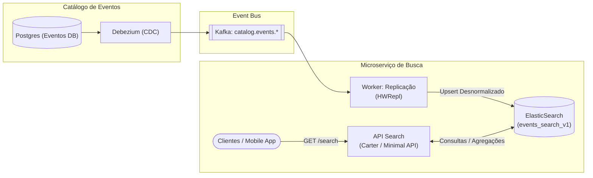

# Especificação de Banco de Dados: Busca (`SVC_BUSCA`)

Este documento especifica a modelagem documental no **ElasticSearch (`Search DB`)**, esquemas de mapeamento (*Mappings*), analisadores fonéticos e de autocompletar em português (*Custom Analyzers*), queries de agregação facetada e geolocalização, além do protocolo de replicação do worker **`HWRepl`** a partir dos eventos de CDC (Debezium / Apache Kafka) para o ecossistema **TicketReserver.IO**.

---

## 1. Visão Geral do Domínio

* **Engine de Busca:** ElasticSearch 8.x (`Search DB`)
* **Cliente .NET:** `Elastic.Clients.Elasticsearch` (v8) ou `NEST`
* **Padrão Arquitetural:** **CQRS Físico**
  * O microserviço de Catálogo (`SVC_EVENTOS`) grava no PostgreSQL relacional normalizado.
  * O Debezium captura as mutações no WAL e publica em tópicos Kafka.
  * O worker de replicação **`HWRepl`** consome esses eventos, desnormaliza os dados em uma visão otimizada para leitura e faz o *Upsert* contínuo no ElasticSearch.
  * A `API Search` atende consultas complexas, buscas textuais tolerantes a erros (*fuzzy*), autocompletar e filtros por geolocalização com latência inferior a **15ms**.



---

## 2. Estrutura do Documento Desnormalizado (`EventSearchDocument`)

Cada documento no índice `events_search_v1` agrega informações de eventos, locais (*venues*) e resumo de preços (*ticket tiers*):

```json
{
  "id": "c1f7a18b-57e3-4c92-bf3d-2495b45c92e1",
  "title": "Coldplay - Music of the Spheres Tour",
  "slug": "coldplay-music-of-the-spheres-sp",
  "description": "Show internacional da turnê mundial no Morumbi.",
  "category": "CONCERT",
  "status": "SALES_OPEN",
  "age_restriction": 16,
  "banner_url": "https://cdn.ticketreserver.io/banners/coldplay-sp.jpg",
  "schedule": {
    "sales_start_at": "2026-11-20T10:00:00Z",
    "sales_end_at": "2026-12-10T22:00:00Z",
    "event_start_at": "2026-12-10T20:30:00Z",
    "event_end_at": "2026-12-10T23:30:00Z"
  },
  "venue": {
    "id": "e2a4f6d8-1122-3344-5566-778899aabbcc",
    "name": "Estádio do Morumbi",
    "city": "São Paulo",
    "state": "SP",
    "country": "BR",
    "location": {
      "lat": -23.6001,
      "lon": -46.7202
    }
  },
  "pricing": {
    "min_price": 240.00,
    "max_price": 980.00,
    "currency": "BRL"
  },
  "tiers_summary": [
    {
      "tier_id": "a1b2c3d4-0000-1111-2222-333344445555",
      "name": "Pista Comum - 1º Lote",
      "price": 240.00,
      "status": "ACTIVE"
    },
    {
      "tier_id": "b2c3d4e5-0000-1111-2222-333344445555",
      "name": "Pista Premium - 1º Lote",
      "price": 490.00,
      "status": "ACTIVE"
    }
  ],
  "tags": ["rock", "pop", "internacional", "estadio", "sao paulo"],
  "updated_at": "2026-11-15T08:00:00Z"
}
```

---

## 3. Definição do Índice e Mappings (ElasticSearch)

### 3.1. Criação do Índice com Analisadores em Português e N-Gram
Utiliza **Asciifolding** (busca sem acento), **Stemmer pt-BR** e **Edge N-Gram** (para busca instantânea enquanto o usuário digita):

```json
PUT /events_search_v1
{
  "settings": {
    "number_of_shards": 2,
    "number_of_replicas": 1,
    "analysis": {
      "filter": {
        "pt_stemmer": {
          "type": "stemmer",
          "language": "brazilian"
        },
        "pt_stop": {
          "type": "stop",
          "stopwords": "_brazilian_"
        },
        "edge_ngram_filter": {
          "type": "edge_ngram",
          "min_gram": 2,
          "max_gram": 15
        }
      },
      "analyzer": {
        "pt_text_analyzer": {
          "type": "custom",
          "tokenizer": "standard",
          "filter": [
            "lowercase",
            "asciifolding",
            "pt_stop",
            "pt_stemmer"
          ]
        },
        "autocomplete_analyzer": {
          "type": "custom",
          "tokenizer": "standard",
          "filter": [
            "lowercase",
            "asciifolding",
            "edge_ngram_filter"
          ]
        }
      }
    }
  },
  "mappings": {
    "properties": {
      "id": { "type": "keyword" },
      "title": {
        "type": "text",
        "analyzer": "pt_text_analyzer",
        "fields": {
          "raw": { "type": "keyword" },
          "autocomplete": {
            "type": "text",
            "analyzer": "autocomplete_analyzer",
            "search_analyzer": "standard"
          }
        }
      },
      "slug": { "type": "keyword" },
      "description": {
        "type": "text",
        "analyzer": "pt_text_analyzer"
      },
      "category": { "type": "keyword" },
      "status": { "type": "keyword" },
      "age_restriction": { "type": "integer" },
      "banner_url": { "type": "keyword", "index": false },
      "schedule": {
        "properties": {
          "sales_start_at": { "type": "date" },
          "sales_end_at": { "type": "date" },
          "event_start_at": { "type": "date" },
          "event_end_at": { "type": "date" }
        }
      },
      "venue": {
        "properties": {
          "id": { "type": "keyword" },
          "name": {
            "type": "text",
            "analyzer": "pt_text_analyzer",
            "fields": { "raw": { "type": "keyword" } }
          },
          "city": { "type": "keyword" },
          "state": { "type": "keyword" },
          "country": { "type": "keyword" },
          "location": { "type": "geo_point" }
        }
      },
      "pricing": {
        "properties": {
          "min_price": { "type": "scaled_float", "scaling_factor": 100 },
          "max_price": { "type": "scaled_float", "scaling_factor": 100 },
          "currency": { "type": "keyword" }
        }
      },
      "tiers_summary": {
        "type": "nested",
        "properties": {
          "tier_id": { "type": "keyword" },
          "name": { "type": "keyword" },
          "price": { "type": "scaled_float", "scaling_factor": 100 },
          "status": { "type": "keyword" }
        }
      },
      "tags": { "type": "keyword" },
      "updated_at": { "type": "date" }
    }
  }
}
```

### 3.2. Gerenciamento por Alias (Zero Downtime)
```json
POST /_aliases
{
  "actions": [
    { "add": { "index": "events_search_v1", "alias": "events_search" } }
  ]
}
```

---

## 4. Padrões de Consulta de Alta Performance

### 4.1. Busca Textual com Filtros e Geolocalização (Exemplo de Query)
Busca por eventos em São Paulo, com termo de pesquisa, filtrando por data e faixa de preço, ordenando por distância ou data:

```json
POST /events_search/_search
{
  "query": {
    "bool": {
      "must": [
        {
          "multi_match": {
            "query": "coldplay morumbi",
            "fields": [
              "title^3",
              "title.autocomplete^2",
              "venue.name^2",
              "tags",
              "description"
            ],
            "fuzziness": "AUTO",
            "operator": "and"
          }
        }
      ],
      "filter": [
        { "term": { "status": "SALES_OPEN" } },
        { "term": { "venue.city": "São Paulo" } },
        {
          "range": {
            "schedule.event_start_at": { "gte": "now/d" }
          }
        },
        {
          "range": {
            "pricing.min_price": { "lte": 500.00 }
          }
        },
        {
          "geo_distance": {
            "distance": "50km",
            "venue.location": {
              "lat": -23.5505,
              "lon": -46.6333
            }
          }
        }
      ]
    }
  },
  "aggs": {
    "categories": {
      "terms": { "field": "category" }
    },
    "cities": {
      "terms": { "field": "venue.city" }
    },
    "price_ranges": {
      "range": {
        "field": "pricing.min_price",
        "ranges": [
          { "to": 100.0 },
          { "from": 100.0, "to": 300.0 },
          { "from": 300.0, "to": 600.0 },
          { "from": 600.0 }
        ]
      }
    }
  },
  "sort": [
    { "schedule.event_start_at": { "order": "asc" } },
    { "_score": { "order": "desc" } }
  ],
  "from": 0,
  "size": 20
}
```

---

## 5. Dinâmica do Worker de Replicação (`HWRepl`)

O worker **`HWRepl`** é um `BackgroundService` em .NET Core que consome os tópicos CDC gerados pelo Debezium:

1. **Tópicos Consumidos:**
   * `catalog.events.events`
   * `catalog.events.venues`
   * `catalog.events.ticket_tiers`
2. **Padrão de Ingestão e Agregação:**
   * **Mutação em Evento (`catalog.events.events`):**
     * Se `op == 'c'` (Create) ou `op == 'u'` (Update): busca os dados relacionados do Venue e Tiers em cache/banco de leitura e executa **Upsert** no ElasticSearch (`index: events_search, id: event.id`).
     * Se `status == 'CANCELLED'` ou `op == 'd'` (Delete): remove o documento do ElasticSearch ou atualiza `status = 'CANCELLED'`.
   * **Mutação em Lotes de Preço (`catalog.events.ticket_tiers`):**
     * Executa update parcial via Script Painless no ElasticSearch:
       ```painless
       // Atualiza a faixa de preços mínima/máxima e a lista de tiers do evento
       ctx._source.pricing.min_price = params.new_min_price;
       ctx._source.pricing.max_price = params.new_max_price;
       ctx._source.tiers_summary = params.updated_tiers;
       ctx._source.updated_at = params.now;
       ```
3. **Resiliência:**
   * `EnableAutoCommit = false` com commit manual do offset Kafka após a confirmação da escrita (*bulk indexing*) no ElasticSearch.
   * Política de Retry com Polly para indisponibilidade temporária do cluster ElasticSearch.

---

## 6. Mapeamento no Domínio .NET 8 (API Search)

Conforme [PROJECT.md](file:///home/thallesteodoro/development/ticket-reservation-pdi/PROJECT.md):

* **Caso de Uso (Vertical Slice):**
  * `Application/Events/SearchEvents/`
    * `SearchEventsQuery.cs`:
      ```csharp
      public record SearchEventsQuery(
          string? SearchTerm,
          string? Category,
          string? City,
          DateTimeOffset? FromDate,
          DateTimeOffset? ToDate,
          decimal? MaxPrice,
          double? Latitude,
          double? Longitude,
          double? DistanceKm,
          int Page = 1,
          int PageSize = 20
      ) : IQuery<SearchEventsResponse>;
      ```
    * `SearchEventsQueryHandler.cs`:
      * Executa a consulta no ElasticSearch via `Elastic.Clients.Elasticsearch`.
      * Mapeia os *hits* e agregações para o DTO de resposta usando método de extensão estático `EventSearchMappingExtensions.ToResponse()`.
* **Endpoint Carter:**
  ```csharp
  app.MapGet("/search", async (
      [AsParameters] SearchEventsRequest request,
      IQueryHandler<SearchEventsQuery, SearchEventsResponse> handler,
      CancellationToken ct) =>
  {
      var query = request.ToQuery();
      var result = await handler.HandleAsync(query, ct);
      var response = new JsonResponse<SearchEventsResponse, object>(StatusCodes.Status200OK, result, null);
      return Results.Ok(response);
  })
  .WithName("SearchEvents")
  .Produces<JsonResponse<SearchEventsResponse, object>>(StatusCodes.Status200OK)
  .WithOpenApi();
  ```
