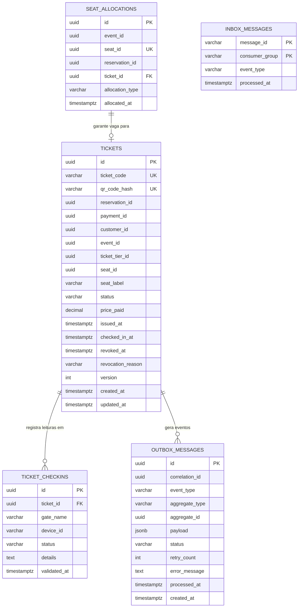
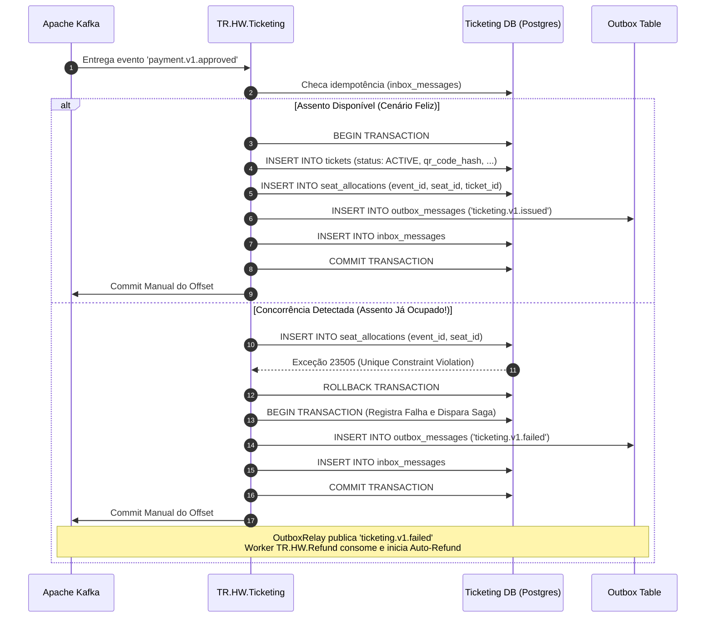

# Especificação de Banco de Dados: Ticketing / Emissão (`SVC_TICKETING`)

Este documento especifica o modelo de dados físico, diagramas de entidade-relacionamento (ERD), definições de DDL (PostgreSQL), mecanismos de validação atômica de assentos contra concorrência extrema e o protocolo do worker **`TR.HW.Ticketing`** para emissão de ingressos com QR Code criptográfico e detecção de colisões que acionam a saga de estorno (**`ticketing.failed`**) no ecossistema **TicketReserver.IO**.

---

## 1. Visão Geral do Domínio

* **Banco de Dados Relacional:** PostgreSQL 16+ (`Ticketing DB`)
* **Papel no Sistema:** 
  * Alocação atômica definitiva do assento/inventário.
  * Emissão do ingresso digital seguro (com QR Code assinado criptograficamente).
  * Controle de catraca / validação de acesso (*Check-in*).
* **Ponto Crítico de Concorrência (Gatilho da Saga):**
  * Caso duas transações passem pelo lock temporário do Redis ou ocorra uma inconsistência de corrida, a tabela `seat_allocations` impõe uma **Unique Constraint** estrita no PostgreSQL: `UNIQUE(event_id, seat_id)`.
  * Se a constraint for violada, o worker `TR.HW.Ticketing` captura a exceção `23505 (unique_violation)`, aborta a emissão e publica o evento **`ticketing.v1.failed`** no Apache Kafka via Outbox, disparando o estorno automático no microsserviço de Pagamento (`TR.HW.Refund`).

---

## 2. Diagrama Entidade-Relacionamento (ERD)



---

## 3. DDL PostgreSQL Completo

```sql
CREATE EXTENSION IF NOT EXISTS "uuid-ossp";

-- ============================================================================
-- 1. ENUMS E TABELA: TICKETS (Ingressos Emitidos)
-- ============================================================================
CREATE TYPE ticket_status_enum AS ENUM (
    'ACTIVE',               -- Ingresso válido e pronto para uso
    'USED',                 -- Já utilizado na catraca (check-in efetuado)
    'REVOKED',              -- Revogado (estorno, fraude ou cancelamento)
    'BLOCKED'               -- Bloqueado temporariamente por investigação
);

CREATE TABLE tickets (
    id UUID PRIMARY KEY DEFAULT uuid_generate_v4(),
    ticket_code VARCHAR(32) NOT NULL,           -- Código amigável (ex: 'TKT-2026-X89J21')
    qr_code_hash VARCHAR(256) NOT NULL,          -- Token criptográfico assinado (HMAC-SHA256)
    reservation_id UUID NOT NULL,
    payment_id UUID NOT NULL,
    customer_id UUID NOT NULL,
    event_id UUID NOT NULL,
    ticket_tier_id UUID NOT NULL,
    seat_id UUID,                               -- NULL para ingressos sem assento numerado (ex: Pista)
    seat_label VARCHAR(80),                     -- 'Setor Oeste, Fila C, Assento 12'
    status ticket_status_enum NOT NULL DEFAULT 'ACTIVE',
    price_paid NUMERIC(12, 2) NOT NULL CHECK (price_paid >= 0),
    issued_at TIMESTAMPTZ NOT NULL DEFAULT NOW(),
    checked_in_at TIMESTAMPTZ,
    revoked_at TIMESTAMPTZ,
    revocation_reason VARCHAR(150),
    version INT NOT NULL DEFAULT 1,             -- Optimistic Concurrency Control
    created_at TIMESTAMPTZ NOT NULL DEFAULT NOW(),
    updated_at TIMESTAMPTZ NOT NULL DEFAULT NOW(),

    CONSTRAINT uq_tickets_code UNIQUE (ticket_code),
    CONSTRAINT uq_tickets_qr_hash UNIQUE (qr_code_hash)
);

-- ============================================================================
-- 2. TABELA: SEAT_ALLOCATIONS (Garantia Atômica de Inventário / Anti-Double Booking)
-- ============================================================================
CREATE TYPE allocation_type_enum AS ENUM (
    'NUMBERED_SEAT',        -- Assento numerado físico
    'GENERAL_ADMISSION'     -- Cota de lote / pista comum
);

CREATE TABLE seat_allocations (
    id UUID PRIMARY KEY DEFAULT uuid_generate_v4(),
    event_id UUID NOT NULL,
    seat_id UUID NOT NULL,                      -- Para pista sem cadeira, ID sintetizado de slot
    reservation_id UUID NOT NULL,
    ticket_id UUID NOT NULL,
    allocation_type allocation_type_enum NOT NULL DEFAULT 'NUMBERED_SEAT',
    allocated_at TIMESTAMPTZ NOT NULL DEFAULT NOW(),

    CONSTRAINT fk_allocations_ticket FOREIGN KEY (ticket_id) REFERENCES tickets(id) ON DELETE RESTRICT,
    -- BARREIRA DE CONCORRÊNCIA: Se 2 workers tentarem gravar a mesma vaga, o Postgres rejeita!
    CONSTRAINT uq_seat_allocations_event_seat UNIQUE (event_id, seat_id)
);

-- ============================================================================
-- 3. TABELA: TICKET_CHECKINS (Auditoria de Validação em Catracas)
-- ============================================================================
CREATE TYPE checkin_status_enum AS ENUM (
    'APPROVED',
    'ALREADY_USED',
    'REVOKED_TICKET',
    'DEVICE_UNAUTHORIZED'
);

CREATE TABLE ticket_checkins (
    id UUID PRIMARY KEY DEFAULT uuid_generate_v4(),
    ticket_id UUID NOT NULL,
    gate_name VARCHAR(60) NOT NULL,             -- ex: 'Portão 3 - Acesso Pista'
    device_id VARCHAR(60) NOT NULL,             -- Identificador do terminal/leitor
    status checkin_status_enum NOT NULL,
    details TEXT,
    validated_at TIMESTAMPTZ NOT NULL DEFAULT NOW(),

    CONSTRAINT fk_checkins_ticket FOREIGN KEY (ticket_id) REFERENCES tickets(id) ON DELETE CASCADE
);

-- ============================================================================
-- 4. TABELA: OUTBOX_MESSAGES (Transactional Outbox)
-- ============================================================================
CREATE TYPE ticketing_outbox_status_enum AS ENUM (
    'PENDING',
    'PROCESSING',
    'PUBLISHED',
    'FAILED'
);

CREATE TABLE outbox_messages (
    id UUID PRIMARY KEY DEFAULT uuid_generate_v4(),
    correlation_id UUID NOT NULL,
    event_type VARCHAR(150) NOT NULL,           -- 'ticketing.issued', 'ticketing.failed'
    aggregate_type VARCHAR(100) NOT NULL,       -- 'Ticket'
    aggregate_id UUID NOT NULL,
    payload JSONB NOT NULL,
    status ticketing_outbox_status_enum NOT NULL DEFAULT 'PENDING',
    retry_count INT NOT NULL DEFAULT 0,
    error_message TEXT,
    processed_at TIMESTAMPTZ,
    created_at TIMESTAMPTZ NOT NULL DEFAULT NOW()
);

-- ============================================================================
-- 5. TABELA: INBOX_MESSAGES (Idempotência de Consumo)
-- ============================================================================
CREATE TABLE inbox_messages (
    message_id VARCHAR(150) NOT NULL,
    consumer_group VARCHAR(100) NOT NULL,
    event_type VARCHAR(150) NOT NULL,
    processed_at TIMESTAMPTZ NOT NULL DEFAULT NOW(),

    CONSTRAINT pk_ticketing_inbox PRIMARY KEY (message_id, consumer_group)
);
```

---

## 4. Índices de Performance e Consulta em Portaria

```sql
-- Busca rápida de ingressos por cliente (Carteira / App Mobile)
CREATE INDEX idx_tickets_customer 
ON tickets (customer_id, status);

-- Busca de ingressos por evento (para borderô e relatórios)
CREATE INDEX idx_tickets_event 
ON tickets (event_id, status);

-- Validação instantânea por código ou hash nas catracas (leitura de alta frequência)
CREATE INDEX idx_tickets_hash_lookup 
ON tickets (qr_code_hash) 
WHERE status = 'ACTIVE';

-- Polling de Outbox
CREATE INDEX idx_ticketing_outbox_pending 
ON outbox_messages (created_at, status) 
WHERE status = 'PENDING';

-- Histórico de leituras por ingresso
CREATE INDEX idx_checkins_ticket ON ticket_checkins (ticket_id);
```

---

## 5. Dinâmica do Worker `TR.HW.Ticketing`



---

## 6. Geração do QR Code Criptográfico (Anti-Fraude)

Para impedir clonagem ou falsificação de ingressos na portaria:

1. **Estrutura do Payload Assinado:**
   * `TicketId` (UUID)
   * `EventId` (UUID)
   * `CustomerId` (UUID)
   * `IssuedAt` (Unix Timestamp)
   * `Signature`: `HMAC-SHA256(TicketId + EventId + CustomerId + IssuedAt, SecretKey)`
2. **Hash Único:** O resultado é codificado em Base64 URL-Safe e gravado no campo `qr_code_hash`.
3. **Leitura na Catraca:** O aplicativo leitor valida a assinatura matemática offline ou consulta o endpoint da API de Portaria com tempo de resposta `< 50ms`.

---

## 7. Mapeamento com Domínio C# .NET 8 (Clean Architecture)

Conforme [PROJECT.md](file:///home/thallesteodoro/development/ticket-reservation-pdi/PROJECT.md):

* **Agregado Raiz `Ticket.cs`:**
  * Métodos de ciclo de vida:
    * `Ticket.Issue(reservationId, paymentId, customerId, eventId, tierId, seatId, seatLabel, price, secretKey)`
    * `CheckIn(string gateName, string deviceId)`: Valida se status é `Active`, transiciona para `Used` e adiciona entrada em `_checkins`.
    * `Revoke(string reason)`: Transiciona para `Revoked` impedindo entrada na catraca.
  * Coleção protegida de leituras:
    ```csharp
    private readonly List<TicketCheckin> _checkins = new();
    public IReadOnlyCollection<TicketCheckin> Checkins => _checkins.AsReadOnly();
    ```
* **Tratamento de Exceção de Concorrência no Handler:**
  ```csharp
  try
  {
      await _unitOfWork.SaveChangesAsync(cancellationToken);
      await _outboxPublisher.PublishAsync(new TicketIssuedIntegrationEvent(...));
  }
  catch (DbUpdateException ex) when (ex.InnerException is PostgresException pg && pg.SqlState == PostgresErrorCodes.UniqueViolation)
  {
      _logger.LogWarning("Colisão de concorrência no assento {SeatId} do evento {EventId}. Acionando compensação.", seatId, eventId);
      
      // Persiste o evento de falha para desencadear a saga de compensação (Auto-Refund)
      await _outboxPublisher.PublishAsync(new TicketingFailedIntegrationEvent(
          ReservationId: command.ReservationId,
          PaymentId: command.PaymentId,
          Reason: "SEAT_ALREADY_ALLOCATED"
      ));
  }
  ```
